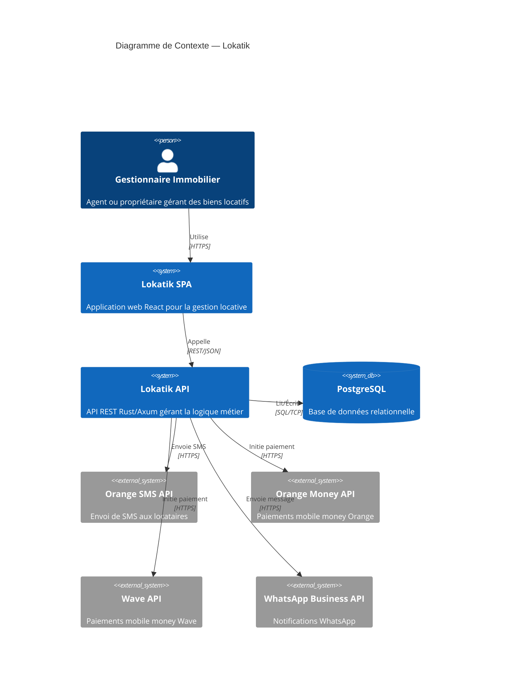
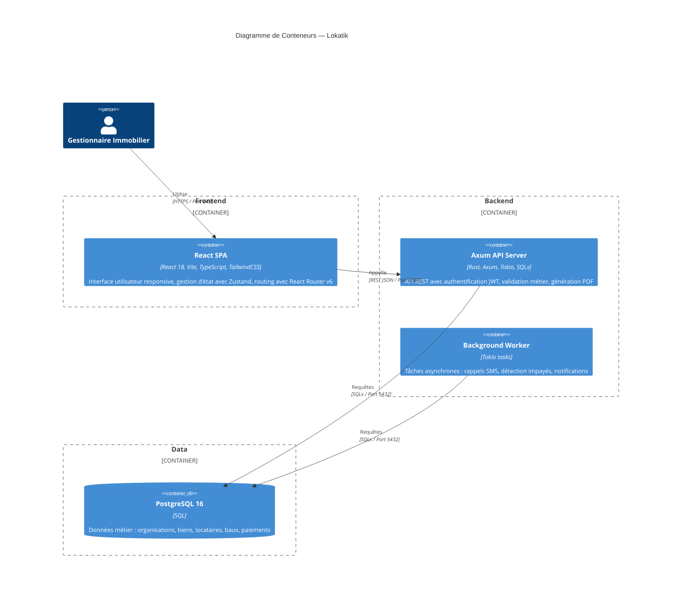
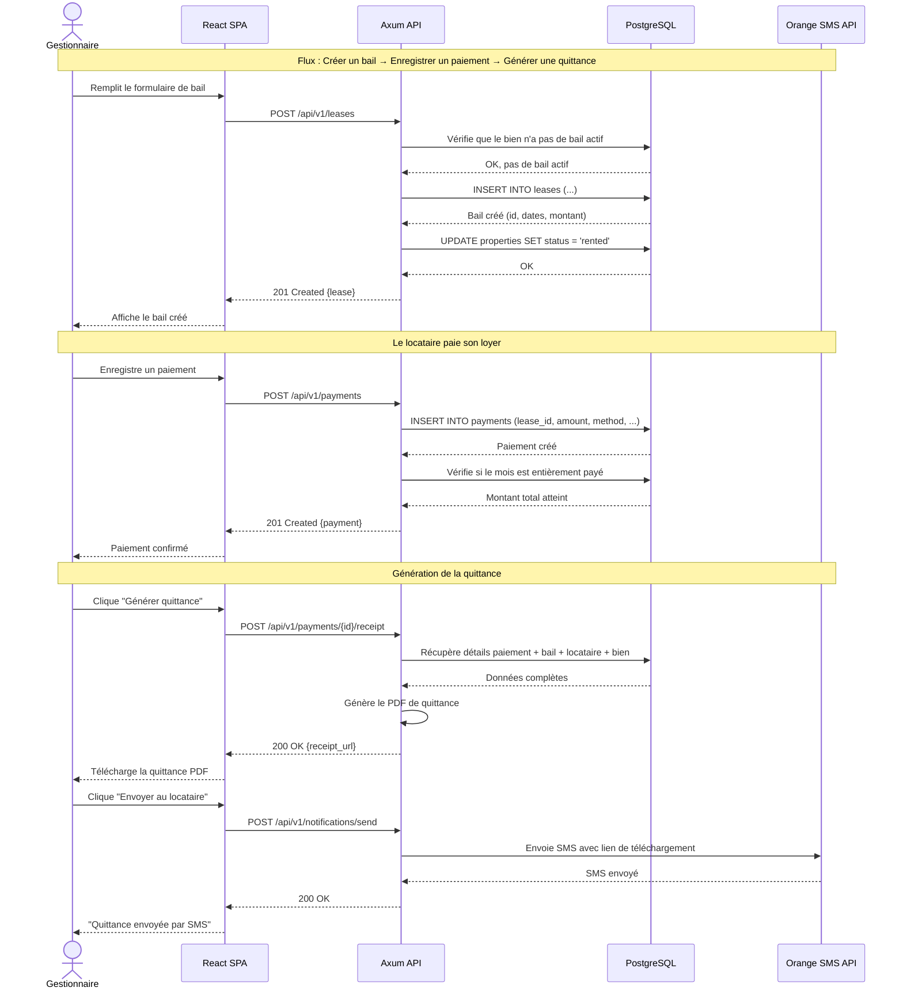
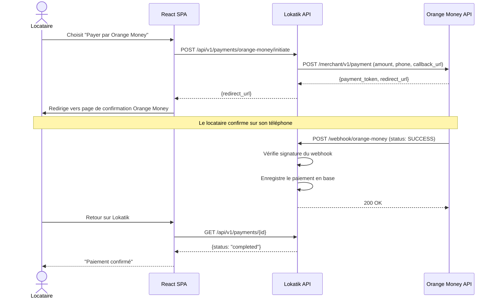
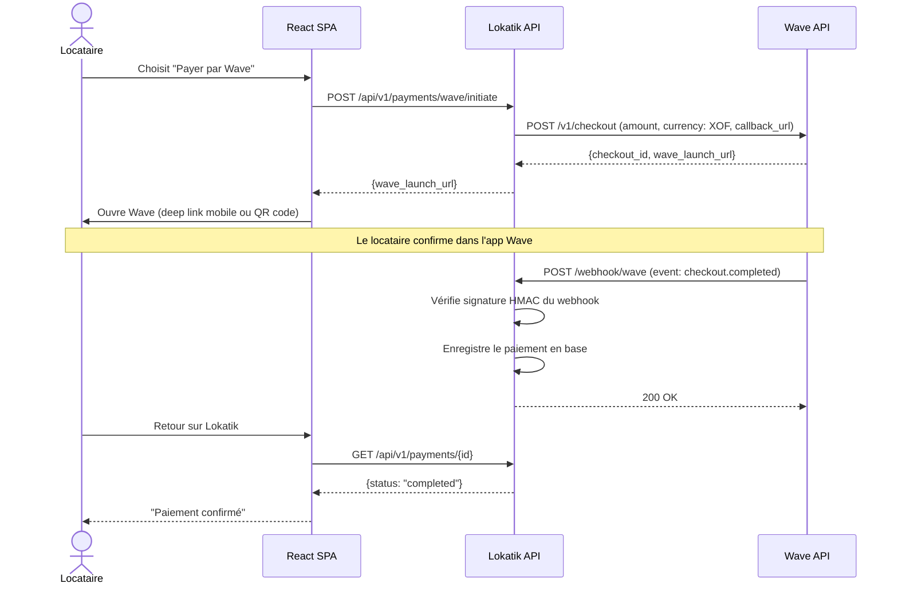
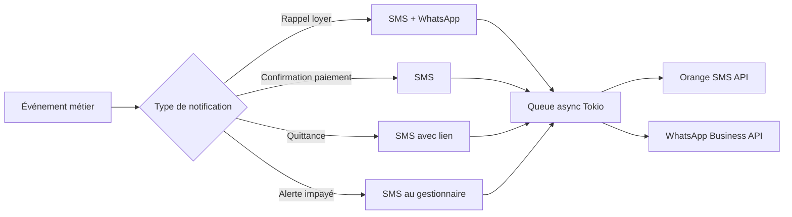

# Architecture Technique — Lokatik SaaS

## Vue d'ensemble

Lokatik repose sur une **architecture 3-tiers classique** adaptée aux contraintes du marché sénégalais :

| Couche | Technologie | Rôle |
|--------|------------|------|
| **Présentation** | React 18 (Vite + TypeScript + TailwindCSS) | SPA servie en statique |
| **API** | Rust (Axum + Tokio + SQLx) | Serveur REST JSON |
| **Données** | PostgreSQL 16 | Stockage relationnel |

L'application est conteneurisée via **Docker** et orchestrée avec **Docker Compose** pour simplifier le déploiement sur VPS.

---

## Diagramme C4 — Contexte



---

## Diagramme C4 — Conteneurs



---

## Description des couches

### 1. Couche Présentation (Frontend)

| Aspect | Choix technique | Justification |
|--------|----------------|---------------|
| **Framework** | React 18 | Écosystème mature, large communauté, facilité de recrutement |
| **Bundler** | Vite 5 | HMR ultra-rapide, build optimisé, configuration minimale |
| **Langage** | TypeScript 5 | Typage statique, meilleure maintenabilité, autocomplétion IDE |
| **État global** | Zustand | Léger (~1KB), API simple, pas de boilerplate comme Redux |
| **Routing** | React Router v6 | Standard de facto, routes imbriquées, lazy loading |
| **Styles** | TailwindCSS 3 | Utility-first, design system cohérent, purge CSS en production |
| **Client HTTP** | Axios | Intercepteurs pour JWT, gestion d'erreurs centralisée |
| **Formulaires** | React Hook Form + Zod | Validation performante côté client, schémas réutilisables |
| **Tableaux** | TanStack Table | Pagination, tri, filtres côté serveur |
| **PDF** | @react-pdf/renderer | Génération de quittances côté client si nécessaire |

**Structure du projet frontend :**

```
frontend/
├── src/
│   ├── api/              # Clients Axios par domaine
│   ├── components/       # Composants réutilisables (UI kit)
│   │   ├── ui/           # Boutons, inputs, modals, tables
│   │   └── layout/       # Header, Sidebar, MainLayout
│   ├── features/         # Modules métier
│   │   ├── auth/         # Login, Register, hooks useAuth
│   │   ├── properties/   # CRUD biens immobiliers
│   │   ├── tenants/      # CRUD locataires
│   │   ├── leases/       # Gestion baux
│   │   ├── payments/     # Suivi paiements
│   │   └── dashboard/    # Tableau de bord
│   ├── hooks/            # Hooks personnalisés
│   ├── lib/              # Utilitaires, config Axios
│   ├── stores/           # Stores Zustand
│   ├── types/            # Types TypeScript partagés
│   └── routes/           # Configuration React Router
├── public/
├── index.html
├── vite.config.ts
├── tailwind.config.js
└── tsconfig.json
```

### 2. Couche API (Backend Rust)

| Aspect | Choix technique | Justification |
|--------|----------------|---------------|
| **Framework web** | Axum 0.7 | Performant, ergonomique, intégré à l'écosystème Tower |
| **Runtime async** | Tokio | Standard Rust pour l'async, multi-threadé |
| **ORM / SQL** | SQLx 0.7 | Requêtes vérifiées à la compilation, pas d'ORM lourd |
| **Authentification** | jsonwebtoken + Argon2 | JWT HS256 pour les tokens, Argon2id pour le hashing |
| **Middleware** | tower-http | CORS, tracing/logging, compression, rate limiting |
| **Sérialisation** | serde + serde_json | Standard Rust, dérivation automatique |
| **Validation** | validator | Validation déclarative des structs d'entrée |
| **Erreurs** | thiserror + anyhow | Erreurs typées pour le domaine, anyhow pour l'infra |
| **PDF** | printpdf ou genpdf | Génération de quittances et contrats |
| **Logging** | tracing + tracing-subscriber | Logging structuré, compatible OpenTelemetry |
| **UUID** | uuid v4 | Identifiants universels pour toutes les entités |

**Structure du projet backend :**

```
backend/
├── src/
│   ├── main.rs                 # Point d'entrée, configuration serveur
│   ├── config.rs               # Chargement configuration (.env)
│   ├── errors.rs               # Types d'erreurs applicatives
│   ├── extractors/             # Extracteurs Axum personnalisés
│   │   └── auth.rs             # Extraction et validation JWT
│   ├── handlers/               # Contrôleurs HTTP
│   │   ├── auth.rs             # Register, Login, Refresh, Me
│   │   ├── properties.rs       # CRUD biens
│   │   ├── tenants.rs          # CRUD locataires
│   │   ├── leases.rs           # CRUD baux
│   │   ├── payments.rs         # CRUD paiements
│   │   └── dashboard.rs        # Agrégations tableau de bord
│   ├── models/                 # Structs de domaine (entités)
│   │   ├── organization.rs
│   │   ├── user.rs
│   │   ├── property.rs
│   │   ├── tenant.rs
│   │   ├── lease.rs
│   │   └── payment.rs
│   ├── repositories/           # Accès données (requêtes SQLx)
│   │   ├── organization_repo.rs
│   │   ├── user_repo.rs
│   │   ├── property_repo.rs
│   │   ├── tenant_repo.rs
│   │   ├── lease_repo.rs
│   │   └── payment_repo.rs
│   ├── services/               # Logique métier
│   │   ├── auth_service.rs
│   │   ├── property_service.rs
│   │   ├── lease_service.rs
│   │   ├── payment_service.rs
│   │   └── notification_service.rs
│   ├── middleware/             # Middleware Tower
│   │   ├── auth.rs            # Vérification JWT
│   │   └── org_context.rs     # Injection contexte organisation
│   └── routes.rs              # Définition des routes
├── migrations/                # Migrations SQLx
│   ├── 001_create_organizations.sql
│   ├── 002_create_users.sql
│   ├── 003_create_properties.sql
│   ├── 004_create_tenants.sql
│   ├── 005_create_leases.sql
│   └── 006_create_payments.sql
├── Cargo.toml
├── Cargo.lock
└── .env.example
```

### 3. Couche Logique Métier

La logique métier est isolée dans la couche **services**, séparée des handlers HTTP et des repositories :

```
Handler (HTTP) → Service (Métier) → Repository (SQL)
     ↑                  ↑                  ↑
  Validation         Règles de          Requêtes
  des entrées        gestion            PostgreSQL
```

**Principes :**

- **Service Layer Pattern** : Chaque domaine (auth, properties, leases, payments) a son service dédié
- **Validation de domaine** : Les règles métier sont vérifiées dans les services, pas dans les handlers
- **Repository Pattern** : Les requêtes SQL sont encapsulées dans des repositories, facilitant les tests
- **Gestion d'erreurs avec `thiserror`** : Chaque erreur métier a un type dédié qui se mappe vers un code HTTP

```rust
// Exemple de type d'erreur métier
#[derive(Debug, thiserror::Error)]
pub enum LeaseError {
    #[error("Le bien {0} a déjà un bail actif")]
    PropertyAlreadyLeased(Uuid),

    #[error("La date de fin doit être postérieure à la date de début")]
    InvalidDateRange,

    #[error("Le montant du loyer doit être positif")]
    InvalidRentAmount,

    #[error("Bail non trouvé")]
    NotFound,
}
```

### 4. Couche Données

| Aspect | Détail |
|--------|--------|
| **SGBD** | PostgreSQL 16 |
| **Driver** | SQLx (async, compile-time checked) |
| **Migrations** | Fichiers SQL versionnés dans `migrations/` |
| **Types** | UUID pour les PKs, TIMESTAMPTZ pour les dates, BIGINT pour les montants (en FCFA, pas de décimales) |
| **Multi-tenant** | Isolation par `organization_id` sur chaque table métier |
| **Triggers** | `updated_at` automatique via trigger PostgreSQL |
| **Index** | Index sur les clés étrangères et les colonnes de recherche fréquentes |

### 5. Infrastructure

| Composant | Technologie |
|-----------|------------|
| **Conteneurisation** | Docker multi-stage builds (builder + runtime) |
| **Orchestration** | Docker Compose (dev + prod) |
| **Reverse proxy** | Nginx |
| **SSL** | Let's Encrypt via Certbot |
| **CI/CD** | GitHub Actions |
| **Hosting** | VPS (Hetzner, DigitalOcean, ou Contabo) |

**Dockerfile backend (multi-stage) :**

```dockerfile
# Stage 1: Build
FROM rust:1.77-slim AS builder
WORKDIR /app
COPY Cargo.toml Cargo.lock ./
COPY src/ src/
COPY migrations/ migrations/
RUN cargo build --release

# Stage 2: Runtime
FROM debian:bookworm-slim
RUN apt-get update && apt-get install -y ca-certificates && rm -rf /var/lib/apt/lists/*
COPY --from=builder /app/target/release/lokatik-api /usr/local/bin/
EXPOSE 8080
CMD ["lokatik-api"]
```

---

## Flux principal — Diagramme de séquence



---

## Intégration Mobile Money

### Orange Money



### Wave



---

## Stratégie de notifications

### SMS (Orange SMS API)

- **Rappels de loyer** : Envoi automatique J-5 et J-1 avant l'échéance
- **Confirmation de paiement** : SMS au locataire après réception du paiement
- **Quittance disponible** : Lien de téléchargement de la quittance
- **Alertes impayés** : Notification au gestionnaire si impayé > 5 jours

### WhatsApp (Business API)

- Canal complémentaire au SMS pour les locataires ayant WhatsApp
- Templates pré-approuvés pour les rappels et confirmations
- Envoi de documents PDF directement dans la conversation

### Architecture des notifications



---

## Sécurité

### Authentification et autorisation

| Mécanisme | Détail |
|-----------|--------|
| **Tokens** | JWT signé HS256, expiration 24h |
| **Refresh** | Token de rafraîchissement, expiration 7 jours |
| **Hashing** | Argon2id pour les mots de passe (résistant aux attaques GPU) |
| **Multi-tenant** | Chaque requête est filtrée par `organization_id` extrait du JWT |
| **Rôles** | `admin` (gestionnaire principal), `agent` (collaborateur), `viewer` (lecture seule) |

### Protection des API

| Mesure | Implémentation |
|--------|---------------|
| **CORS** | `tower-http::CorsLayer` — origines autorisées uniquement |
| **Rate limiting** | `tower_governor` — 100 req/min par IP, 10 req/min pour login |
| **Validation** | `validator` crate — toutes les entrées sont validées |
| **SQL Injection** | Impossible avec SQLx (requêtes paramétrées et vérifiées à la compilation) |
| **HTTPS** | Obligatoire en production via Nginx + Let's Encrypt |
| **Headers** | `X-Content-Type-Options`, `X-Frame-Options`, `Strict-Transport-Security` |

### Données sensibles

- Les mots de passe ne sont jamais stockés en clair (Argon2id)
- Les tokens JWT ne contiennent que `user_id`, `organization_id`, et `role`
- Les clés API (Orange Money, Wave, SMS) sont stockées en variables d'environnement
- Les logs ne contiennent jamais de données personnelles identifiables
