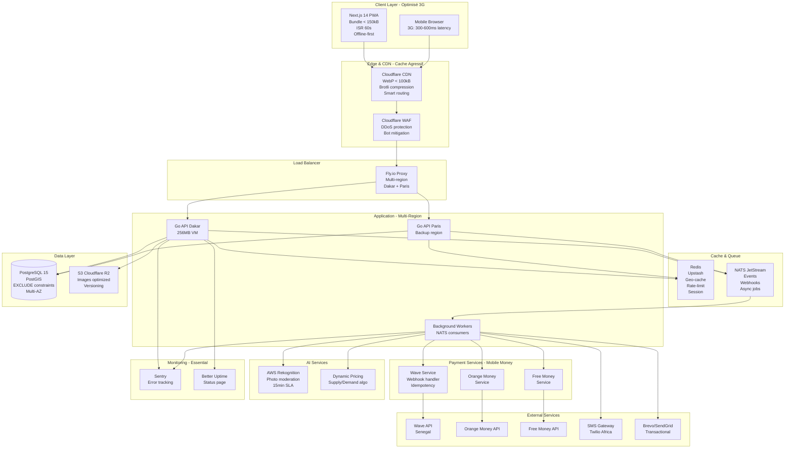
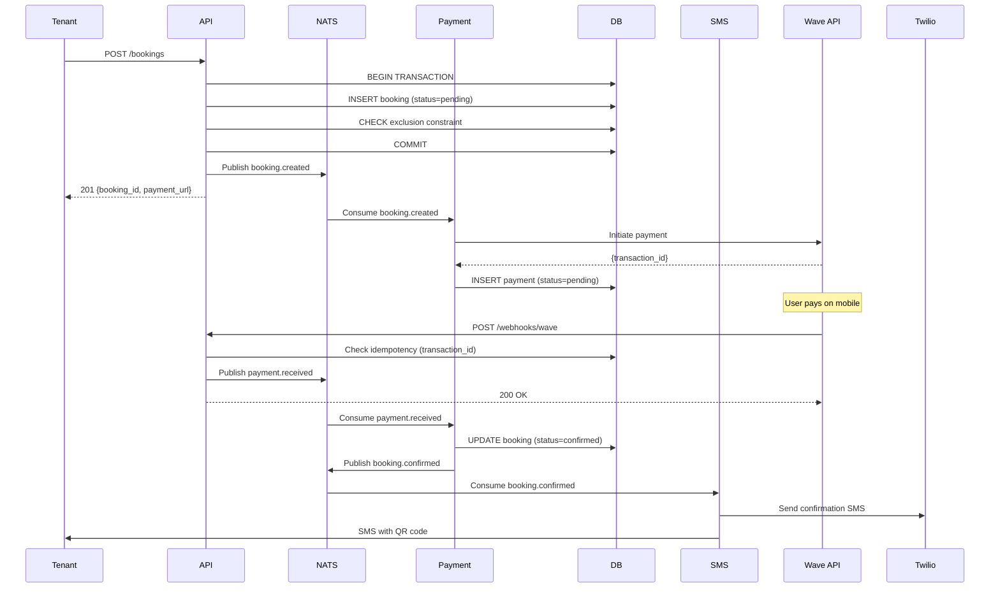
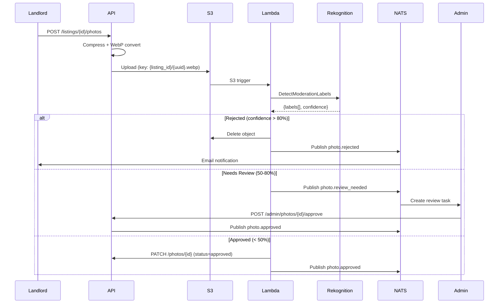
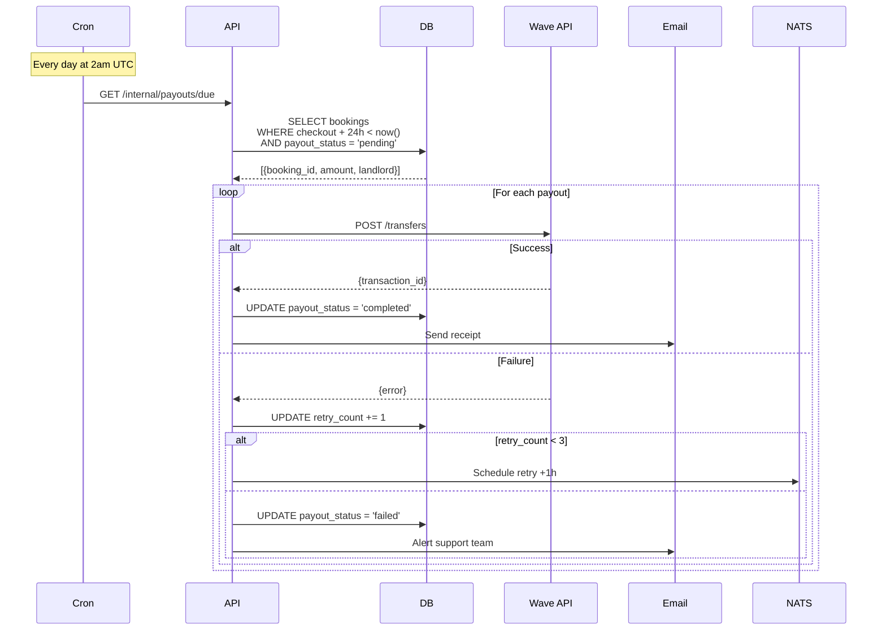

# Architecture Immobilier-SaaS - Contexte Africain

## Vision Stratégique

**Mission:** Devenir la référence SaaS africaine de location courte & moyenne durée.

**Marchés cibles:**
- Phase 1 (6 semaines): Sénégal (Dakar, Saint-Louis, Saly)
- Phase 2 (M3-4): Côte d'Ivoire (Abidjan)
- Phase 3 (M6-12): Maroc (Casablanca, Marrakech)

**Objectifs de Performance:**
- Time-to-market: 6 semaines MVP production-ready
- Scalabilité: 1k → 100k listings sans refactor
- Performance: < 200ms p99 (avec 3G)
- SLA: 99.9% uptime
- Conversion: Recherche → Réservation > 8%
- Taux occupation: > 75%

## Architecture Globale Optimisée 3G



## Contraintes & Décisions Architecturales

### Réseau 3G (300-600ms latency)

**Contraintes:**
- Latence élevée
- Bande passante limitée
- Connexions intermittentes

**Solutions:**
1. **Bundle size optimization**
   - Next.js bundle < 150kB (route-based splitting)
   - Lazy loading components
   - Tree shaking agressif

2. **Image optimization**
   - WebP format automatique
   - Compression < 100kB par image
   - Lazy loading + blur placeholder
   - CDN avec smart compression

3. **Cache strategy**
   - ISR 60s pour listings
   - Stale-while-revalidate
   - Service Worker cache-first
   - Offline fallback pages

4. **API optimization**
   - Response compression (Brotli)
   - Pagination cursor-based
   - GraphQL-like field selection
   - Batch endpoints

### Paiement Mobile Dominant

**Providers:**
- Wave (leader Sénégal): 65% market share
- Orange Money: 25%
- Free Money: 10%

**Challenges:**
- APIs non-idempotentes
- Webhooks non garantis
- Duplications possibles
- Timeouts fréquents

**Solutions:**
1. **Idempotency layer**
```go
type PaymentWebhook struct {
    ID              uuid.UUID `db:"id"`
    Provider        string    `db:"provider"`
    TransactionID   string    `db:"transaction_id"` // UNIQUE
    PayloadHash     string    `db:"payload_hash"`   // UNIQUE
    ProcessedAt     *time.Time `db:"processed_at"`
    Status          string    `db:"status"`
}

// Index unique pour prévenir duplications
CREATE UNIQUE INDEX idx_webhooks_transaction
ON payment_webhooks(provider, transaction_id);
```

2. **Webhook reliability**
   - Réponse 200 OK en < 2s
   - Traitement async via NATS
   - Retry exponential backoff
   - Dead letter queue après 5 échecs

3. **Reconciliation quotidienne**
   - Cron compare DB vs Provider API
   - Alerte si écart > 1%
   - Export CSV pour comptabilité

### Double-Booking Prevention

**Solution PostgreSQL:**
```sql
CREATE TABLE bookings (
    id            uuid PRIMARY KEY,
    listing_id    uuid REFERENCES listings(id),
    tenant_id     uuid REFERENCES users(id),
    status        varchar(20) CHECK (status IN
                    ('pending','confirmed','cancelled','completed')),
    date_range    daterange NOT NULL,

    -- Exclusion constraint: empêche overlap
    EXCLUDE USING gist (
        listing_id WITH =,
        date_range WITH &&
    ) WHERE (status IN ('pending', 'confirmed'))
);

-- Index pour performance
CREATE INDEX idx_bookings_listing_dates
ON bookings USING gist (listing_id, date_range);
```

**Transaction isolation:**
```go
// SERIALIZABLE isolation pour prévenir race conditions
tx, err := db.BeginTx(ctx, &sql.TxOptions{
    Isolation: sql.LevelSerializable,
})
```

### Offline-First Strategy

**PWA Requirements:**
- Manifest.json avec icons
- Service Worker cache
- Background sync
- Offline fallback

**QR Code Check-in Offline:**
```go
// JWT signé contenant booking info
type CheckInToken struct {
    BookingID   uuid.UUID `json:"booking_id"`
    ListingID   uuid.UUID `json:"listing_id"`
    TenantID    uuid.UUID `json:"tenant_id"`
    ValidFrom   time.Time `json:"valid_from"`
    ValidUntil  time.Time `json:"valid_until"`
    jwt.RegisteredClaims
}

// Généré à la confirmation paiement
// Peut être validé offline via clé publique
```

### KYC pour Propriétaires

**Flow:**
1. Upload CNI (recto/verso)
2. Selfie photo
3. Vérification OCR + face matching
4. Validation manuelle si score < 80%
5. Statut: pending → verified → approved

**Storage:**
```go
type KYCDocument struct {
    ID              uuid.UUID `db:"id"`
    UserID          uuid.UUID `db:"user_id"`
    Type            string    `db:"type"` // cni, passport, selfie
    S3URL           string    `db:"s3_url"`
    OcrData         jsonb     `db:"ocr_data"`
    VerificationScore float64 `db:"verification_score"`
    Status          string    `db:"status"`
    ReviewedBy      *uuid.UUID `db:"reviewed_by"`
    ReviewedAt      *time.Time `db:"reviewed_at"`
}
```

## Performance Targets

### SLIs (Service Level Indicators)

| Métrique | Target | Mesure | Alert |
|----------|--------|--------|-------|
| API p99 latency | < 200ms | Prometheus histogram | > 300ms |
| Search p99 | < 150ms | Redis + PG explain | > 250ms |
| Payment webhook | < 2s | NATS ack time | > 3s |
| Image load (3G) | < 3s | Lighthouse | > 5s |
| PWA offline | 100% | Service worker cache | < 95% |
| Uptime | 99.9% | Better Uptime | < 99.5% |

### Core Web Vitals

| Métrique | Target 3G | Target 4G | Mesure |
|----------|-----------|-----------|--------|
| LCP (Largest Contentful Paint) | < 3.5s | < 2.5s | Lighthouse |
| FID (First Input Delay) | < 100ms | < 100ms | RUM |
| CLS (Cumulative Layout Shift) | < 0.1 | < 0.1 | Lighthouse |
| TTI (Time to Interactive) | < 5s | < 3.5s | Lighthouse |

### Capacity Planning

| Phase | Timeline | Listings | Users | API RPS | DB Size | Monthly Cost |
|-------|----------|----------|-------|---------|---------|--------------|
| MVP | S1-2 | 1,000 | 500 | 10 | 1 GB | $50 |
| Beta | S3-6 | 5,000 | 2,500 | 50 | 5 GB | $150 |
| Launch | M3-4 | 20,000 | 10,000 | 200 | 20 GB | $400 |
| Scale | M6 | 50,000 | 30,000 | 500 | 100 GB | $800 |
| Regional | M12 | 100,000 | 100,000 | 1,000 | 500 GB | $1,500 |

## Budget Contraints - MVP ($50/mois)

| Service | Plan | Cost/mois | Specs |
|---------|------|-----------|-------|
| Fly.io API | Hobby | $10 | 256MB RAM, 1 vCPU shared |
| Fly.io Postgres | Hobby | $15 | db.t3.micro equivalent |
| Upstash Redis | Free | $0 | 10k commands/day |
| Cloudflare R2 | Free tier | $0 | 10GB storage |
| Cloudflare CDN | Free | $0 | Unlimited bandwidth |
| Better Uptime | Free | $0 | 1 monitor |
| Sentry | Free | $0 | 5k events/month |
| Brevo Email | Free | $0 | 300 emails/day |
| **TOTAL** | | **$25** | Buffer $25 |

### Upgrade Path (M3+)

| Service | Plan | Cost/mois | Specs |
|---------|------|-----------|-------|
| Fly.io API | Production | $50 | 2x 512MB RAM |
| Fly.io Postgres | Production | $60 | Multi-region, backup |
| Upstash Redis | Pro | $20 | 1M commands/day |
| Cloudflare R2 | Paid | $10 | 100GB storage |
| Better Uptime | Starter | $20 | 10 monitors, status page |
| Sentry | Team | $26 | 50k events/month |
| Brevo Email | Lite | $25 | 10k emails/month |
| **TOTAL** | | **$211** | |

## Menaces & Mitigations

### 1. Fraude Payment

**Risques:**
- Stolen wallet
- SIM swap
- Replay attacks

**Mitigations:**
- Velocity limits (max 3 payments/hour/user)
- Blacklist Redis cache
- OTP email obligatoire pour IBAN change
- Device fingerprinting
- Fraud score (rule-based)

### 2. Réglementaire

**Risques:**
- Taxe séjour variable par ville
- TVA changement
- Licence location courte durée

**Mitigations:**
- Module taxes externalisé
- Config YAML par région
```yaml
taxes:
  dakar:
    sejour: 5%  # du montant location
    tva: 18%
  saint_louis:
    sejour: 3%
    tva: 18%
```

### 3. Traffic Burst

**Scénario:** Influenceur poste lien

**Mitigations:**
- Fly.io autoscaling (CPU 60% target)
- NATS queue buffer 10k messages
- Redis circuit breaker
- Rate limiting agressif
- CDN cache shield

### 4. Coupure Régionale

**Scénario:** Fibre Dakar coupée 4h

**Mitigations:**
- Multi-region Fly.io (Dakar + Paris)
- RDS Multi-AZ
- PWA offline mode
- Status page (Better Uptime)
- Failover automatique < 30s

## Workflows Métier Critiques

### 1. Réservation avec Paiement



### 2. Modération Photo



### 3. Reversement Propriétaire



## Roadmap Technique

### Phase 1: MVP (Semaines 1-6)

**Objectif:** Production-ready avec paiement local

- [ ] Auth JWT + refresh token
- [ ] CRUD listings avec PostGIS
- [ ] Search geo + filtres
- [ ] Booking avec exclusion constraint
- [ ] Paiement Wave (priorité)
- [ ] Webhook idempotent
- [ ] PWA basique (offline listings)
- [ ] Admin modération manuelle
- [ ] Deploy Fly.io mono-region
- [ ] Monitoring Sentry + Better Uptime

**Équipe:** 1 full-stack

**Infra:** Fly.io $25/mois

### Phase 2: Beta (Semaines 7-12)

**Objectif:** Orange Money, optimisation 3G, KYC

- [ ] Paiement Orange Money + Free Money
- [ ] KYC automatisé (OCR)
- [ ] Image optimization pipeline (WebP < 100kB)
- [ ] ISR 60s pour SEO
- [ ] Dynamic pricing v1 (rule-based)
- [ ] QR code check-in
- [ ] PWA offline-first complète
- [ ] Tests load (k6)

**Équipe:** 1 full-stack + 1 designer

**Infra:** $150/mois

### Phase 3: Production (M3-4)

**Objectif:** 20k listings, Côte d'Ivoire

- [ ] Multi-region (Dakar + Paris)
- [ ] Modération IA (Rekognition)
- [ ] Dynamic pricing ML
- [ ] Push notifications
- [ ] Programme fidélité
- [ ] Assurance loyer intégrée
- [ ] Mobile app PWA installable
- [ ] Tests e2e Playwright

**Équipe:** 2 full-stack + 1 mobile + 1 DevOps

**Infra:** $400/mois

### Phase 4: Scale (M6-12)

**Objectif:** 100k listings, 3 pays

- [ ] Maroc expansion
- [ ] B2B API (agences)
- [ ] ERP sync (exports comptables)
- [ ] Pricing ML advanced
- [ ] Chatbot support
- [ ] Analytics dashboard
- [ ] A/B testing framework

**Équipe:** 5 engineers + 2 data

**Infra:** $1,500/mois

---

**Version:** 1.0
**Dernière mise à jour:** 7 novembre 2025
**Maintenu par:** Équipe Architecture Immobilier-SaaS
