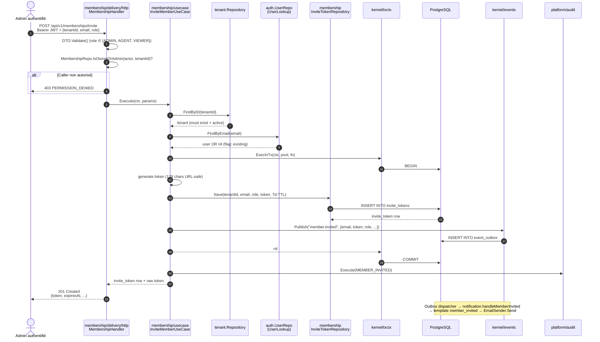
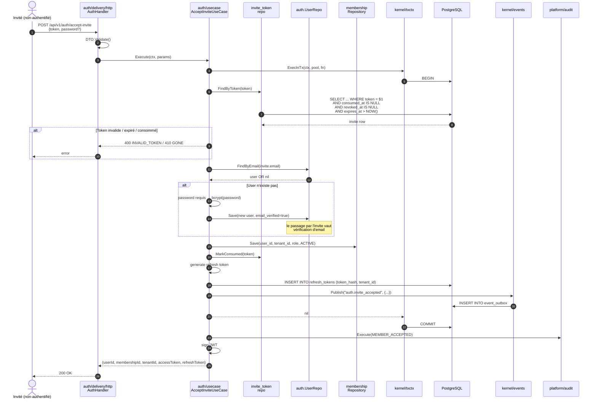

# Séquence — Invitation & acceptation d'un membre

Deux flux distincts qui se rejoignent côté DB sur la table `invite_tokens` (RFC-0018 §6). Le token brut **n'est jamais persisté en clair après émission** — il est dans la réponse HTTP de `/invite` (à transmettre au mail) et stocké tel quel dans `invite_tokens.token` avec un index partial unique sur les rows pending.

---

## 1. Invitation (OWNER/ADMIN invite un email)

---

## 2. Acceptation (invité clique sur le lien dans le mail)

## Invariants

| # | Invariant | Implémentation |
|---|---|---|
| 1 | **Pas de double-redemption** | `UNIQUE(token)` + `consumed_at IS NULL` partial index. Race tx isole. |
| 2 | **Pas de membership PENDING** | RFC-0018 §6 remplace le couple `(membership PENDING + token)` par un seul `invite_token` row. |
| 3 | **Email auto-vérifié à l'acceptation** | Le clic sur le lien dans le mail = preuve de possession de l'email. Pas de `email_verification_tokens` row pour ce parcours. |
| 4 | **Token ne porte AUCUN PII en lui-même** | C'est juste une chaîne aléatoire. Email + rôle vivent en DB. |
| 5 | **Réinvitation après révocation** | `UNIQUE(user_id, tenant_id) WHERE status != 'REVOKED'` → un user révoqué peut être réinvité. |

## Références code

- `platform/membership/usecase/invite.go` — flux invite.
- `platform/auth/usecase/accept_invite.go` — flux accept.
- `platform/membership/migrations/0003_create_invite_tokens.up.sql`.
- [RFC-0018](../rfcs/0018-Amendements-B2B-Onboarding.md) §6.
