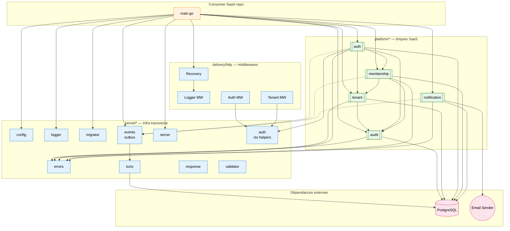

# Layering & dépendances inter-modules

Vue d'ensemble des packages livrés (v0.1.0) et de leurs dépendances. Aligné avec ADR-0002 (Clean Architecture 3 niveaux) et RFC-0038 (conventions de package).

## Lecture

- **`kernel/*`** ne dépend que de la stdlib + pgx/pgxpool + slog. **Aucune** dépendance vers `platform/*` (enforced par `scripts/lint.sh`).
- **`platform/*`** dépend de `kernel/*` et **peut** dépendre d'autres `platform/*` (ex. `auth → membership → tenant → audit`). Le cycle audit↔membership est **cassé** en construisant les repos hors des modules (cf. `examples/saas-b2b/main.go` étape 3).
- **`delivery/http`** héberge les middlewares partagés (Recovery, Logger MW, Auth MW, Tenant MW). Les routes sont déclarées **par module** via `RegisterRoutes(mux)`.
- Flèches **pleines** = appel synchrone. Flèches **pointillées** = publication d'événement outbox (asynchrone, at-least-once).

## Composition côté consommateur

L'ordre canonique du wiring dans `main.go` :

1. `config.Load()` → variables d'env.
2. `logger.New()` → fan-out slog.
3. `pgxpool.New()` → pool DB partagé.
4. `migrator.Run([events, tenant, auth, membership, audit, notification], ...)`.
5. `events.New()` → bus outbox.
6. Construction des repos (un seul instance par repo, partagé entre modules).
7. Construction des modules (`audit.New`, `tenant.New`, `membership.New`, `auth.New`, `notification.New`).
8. `notifMod.Subscribe(bus)` **avant** `bus.Run(ctx)`.
9. `module.RegisterRoutes(mux)` pour chaque module.
10. `server.New(cfg, deliveryhttp.ApplyGlobalMiddlewares(mux, log)).Start()`.

Le canonique complet vit dans [`examples/saas-b2b/main.go`](../../../examples/saas-b2b/main.go).
