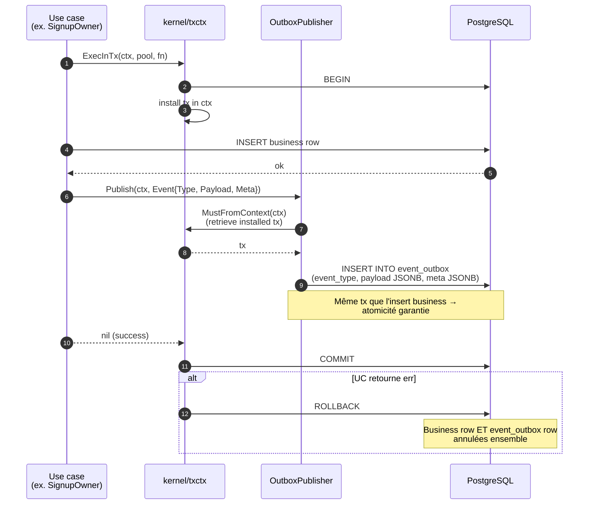
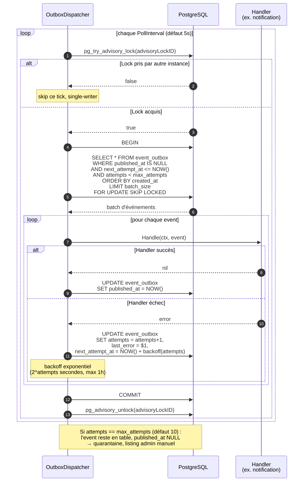

# Séquence — Outbox transactionnel (publish + dispatch)

RFC-0015 v1.1 — at-least-once via PostgreSQL outbox + single-writer dispatcher avec `pg_try_advisory_lock`. Garantit qu'un événement n'est pas perdu si le commit business commit, et qu'il n'est pas publié si la tx rollback.

---

## Publish (côté use case)

## Dispatch (goroutine `bus.Run(ctx)`)

## Garanties

| Garantie | Mécanisme |
|---|---|
| **At-least-once** | Pas d'`ACK before commit`. Si crash après handler succès mais avant `UPDATE published_at`, le handler sera rejoué au prochain poll. |
| **Atomicité publish/business** | `INSERT INTO event_outbox` dans la même tx que le business write. |
| **Single-writer** | `pg_try_advisory_lock` rend `bus.Run` idempotent — déployer N instances ne duplique pas. |
| **Pas de starvation** | `SKIP LOCKED` permet à un instance B de prendre un event que l'instance A vient de skip à cause d'un lock row, sans deadlock. |
| **Backoff** | Exponentiel `2^attempts` borné à 1h. Évite d'éroder le throughput sur une dépendance down. |

## Antipatterns à éviter

- ❌ **Publish hors tx** : `Publisher.Publish` lève `txctx.ErrNoTx`. C'est volontaire — un event publié hors tx peut leaker un état non commité.
- ❌ **Handler avec side-effects non-idempotents** : un email peut être envoyé deux fois (at-least-once). Le handler `notification` log dans `notification_logs` chaque tentative → l'opérateur voit les doublons, mais le destinataire aussi.
- ❌ **Long handler bloquant** : un handler de 30s bloque tout le batch. Si nécessaire, faire le handler enqueue → travail async hors batch.

## Configuration recommandée

| Champ `events.Config` | Dev | Prod |
|---|---|---|
| `PollInterval` | 1s | 5s |
| `BatchSize` | 10 | 50 |
| `MaxAttempts` | 3 | 10 |
| `AdvisoryLockID` | constant (ex. `0x6F75747820626F78`) | idem (doit être stable entre déploiements) |

## Références code

- `kernel/events/publisher.go` — OutboxPublisher.
- `kernel/events/dispatcher.go` — OutboxDispatcher.
- `kernel/events/migrations/0001_create_event_outbox.up.sql`.
- [RFC-0015](../rfcs/0015-Event-Bus-Interne.md) — spec complète.
