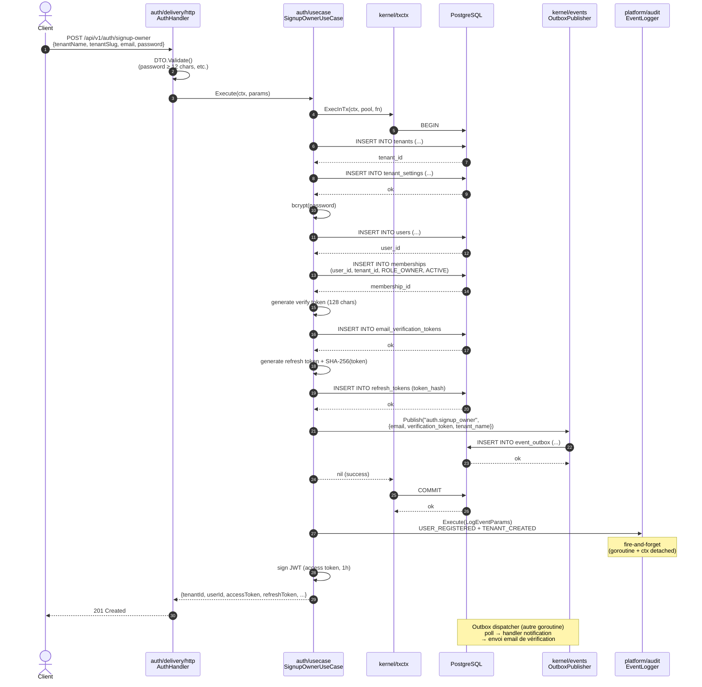

# Séquence — `POST /api/v1/auth/signup-owner`

Crée tenant + user + membership OWNER + token de vérification email + access/refresh tokens, dans **une seule transaction**. Émet un événement `auth.signup_owner` dans la même tx.

## Invariants

| # | Invariant | Justification |
|---|---|---|
| 1 | **Tout ou rien** | La tx couvre tenants → users → memberships → tokens → event_outbox. Un rollback annule **toutes** les écritures, y compris l'événement → pas de fantôme d'email envoyé sans user persisté. |
| 2 | **Audit hors tx** | `Audit.Execute` se déclenche après le commit. Si l'audit échoue, le signup reste valide (ADR-0009 best-effort). |
| 3 | **Refresh token tenant-scoped** | À la création, le token est lié au tenant qu'on vient de créer (`refresh_tokens.tenant_id` non-nul). Les login suivants émettront des tokens non-scopés. |
| 4 | **Email non-vérifié ≠ blocage** | L'access token est délivré immédiatement (`EmailVerificationPending: true`). Les login ultérieurs **exigent** la vérification (RFC-0018 §4). |

## Variantes d'échec

- **Slug déjà pris** : `409 Conflict` → `TENANT_ALREADY_EXISTS`.
- **Email déjà pris** : `409 Conflict` → `USER_ALREADY_EXISTS`.
- **Password < 12 chars** : `422 Unprocessable Entity` → `VALIDATION_FAILED`.
- **Publisher nil** (mode dégradé) : la tx commit sans émettre l'événement → pas d'email envoyé. Mode dev/test uniquement.

## Références code

- `platform/auth/usecase/signup_owner.go` — orchestrateur.
- `platform/auth/delivery/http/handler.go` — handler.
- `platform/auth/domain/email.go` — validation.
- [RFC-0018](../rfcs/0018-Amendements-B2B-Onboarding.md) §3 — spec.
